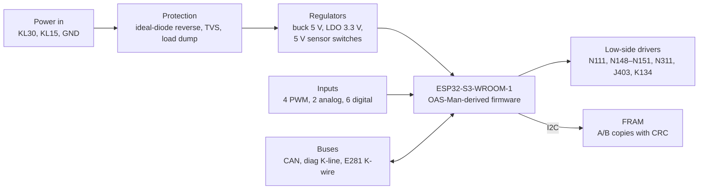

# Hardware

Design v0.1. Net names only. No harness pin numbers on the schematic.

KiCad: [../../hardware/allroad-j197/](../../hardware/allroad-j197/).

```
hardware/allroad-j197/
  allroad-j197.kicad_pro
  allroad-j197.kicad_sch      30 global labels, block notes, no connectors
  nets.csv
  LICENSES.md
  reference/                  unmodified OAS-Man V4.0.1 + OpenHaldex-C6 copies
```

## Block diagram



## MCU

**ESP32-S3-WROOM-1-N8R2**, not the ESP32-WROOM-32 on OAS-Man.

Same Arduino-ESP32 core family. More GPIO, native USB, TWAI CAN. OAS-Man solenoid, compressor, and manifold classes can port. PWM capture for the four height sensors needs new code; OAS-Man height mode today is analogue (`readPinPressure(..., heightMode)`).

Suggested first firmware env name, when one is added: `allroad_j197_dev`. Do not overload `manifold_v4_dev`.

## CAN

TJA1051T/3 or TCAN1462-Q1, PESD2CAN ESD, following the OpenHaldex-C6 front end.

Split 60 Ω termination left unpopulated. J197 is a drive-CAN node, not the only terminator.

**Listen-only until the drivetrain bus is decoded.** Do not transmit. See [FIRMWARE_PLAN.md](FIRMWARE_PLAN.md).

## K-line

Two ST L9637D:

1. Diagnostic K-wire — VCDS address 34. Protocol most likely KWP1281 (unverified). See [DIAGNOSTICS_VCDS.md](DIAGNOSTICS_VCDS.md).
2. E281 K-wire — dash buttons and LEDs. Protocol unknown. SSP 243: this wire is not the diagnostic K-line.

ESP32-S3 UART. 5-baud init on the diagnostic line detected with a GPIO interrupt.

## Drivers

Eight ST VNL5050S5-E protected low-side switches (~50 mΩ, built-in clamp and current limit):

| Output net | Load |
|------------|------|
| `OUT_N148` | FL strut valve |
| `OUT_N149` | FR strut valve |
| `OUT_N150` | RL strut valve |
| `OUT_N151` | RR strut valve |
| `OUT_N111` | Discharge / dryer valve |
| `OUT_N311` | Accumulator valve |
| `OUT_J403` | Compressor **relay coil** (not the motor) |
| `OUT_K134` | Warning lamp |

Compressor motor current stays on the stock J403 relay and stock wiring. The board does not PWM the motor.

Valves are closed without current (SSP 243). Safe default: all driver inputs low, valves shut.

`J431_PWR` is a power feed to the headlamp-range unit (so left height sensors stay alive in run-on). It is not one of the eight low-sides. Treat it as a switched supply, not a solenoid driver. Circuit not drawn yet.

## Inputs

| Kind | Nets | Front end (draft) |
|------|------|-------------------|
| PWM height | `SENS_FL_PWM`, `SENS_FR_PWM`, `SENS_RL_PWM`, `SENS_RR_PWM` | SN74LVC1G17 Schmitt + 10 k / 4.7 V clamp (OpenHaldex BZT52C4V7 style) |
| Analogue | `PRESS_G291`, `TEMP_G290` | Divider / clamp into ADC. G291 is a voltage; G290 is a temperature sensor on the compressor head |
| Digital | `DOOR_IN`, `CL_PULSE`, `KL50_IN`, `TRAILER_IN`, `SPEED_IN`, `E281_RAISE` | 12 V-tolerant, referenced after protection |

Right-hand sensors get `V5_SENS_RH` from this board. Left-hand sensors get 5 V from J431, which this board must keep powered via `J431_PWR` whenever J197 would have been awake.

## Power and protection

| Stage | Part (draft) | Role |
|-------|----------------|------|
| Reverse | LM74700-Q1 + P-FET (AGM30P14MBP or IPD-type) | Ideal diode. OpenHaldex uses AGM30P14MBP |
| Load dump | SMDJ33CA | Clamp ahead of the buck |
| Buck | LM5164-Q1 | 5 V, input rated to 100 V |
| Logic | TLV76733-Q1 or AMS1117-3.3 | 3.3 V for the S3 |
| Sensor 5 V | two TPS7B4253-Q1 tracking LDOs | Short-proof 5 V for RH sensors and G291 |
| Brownout | ADC on KL30 | If the rail sags, park all valve drivers closed |

Do not power the S3 from USB while KL30 is live until the ideal-diode path is checked.

## FRAM

Infineon FM24CL16B (2 KB, I2C, ~10^14 writes). Pin-compatible in spirit with the 24C16 the stock module is said to use (unverified).

Store calibration as copy A and copy B, each with CRC32 and a sequence counter. A torn write must not produce the 65535-class internal fault. See [FIRMWARE_PLAN.md](FIRMWARE_PLAN.md).

## Connector strategy

Mating housings exist as harness-side parts. No PCB-mount header matching J197 was found.

**v0.1: pigtail.** Short harness from donor plugs (or plugs cut from a salvage J197) to a sealed Deutsch DT or TE AMPSEAL 35 on the board.

**v0.2 option:** desolder the header from a dead J197 and reuse it on the new PCB as a true drop-in.

| Pigtail | Reused original header |
|---------|------------------------|
| Buildable now; no unknown PCB header | True drop-in; less harness in the wet zone |
| Board can be debugged on the bench | Needs a dead module and the exact footprint |
| Needs space behind the trim; more crimps in a wet area | Cannot start until the header is measured |

## Environment

- Acrylic conformal coat (HumiSeal 1B31 or equal)
- IP67 enclosure with a vent membrane
- Mount with the plugs facing down
- Water is a known stock-module kill

## Licence on the hardware

Firmware: GPL-3.0 (OAS-Man). Copied OpenHaldex-C6 blocks: MIT, keep the notice. See [../../hardware/allroad-j197/LICENSES.md](../../hardware/allroad-j197/LICENSES.md).
